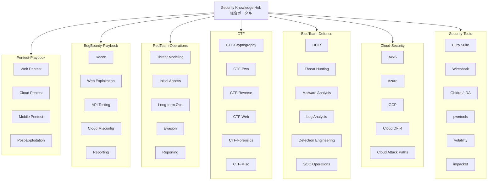

---

# 🏛 **Security Knowledge Hub**  
セキュリティ学習メモのポータル  
（Pentest / Bug Bounty / Red Team / CTF / Blue Team / Cloud / Tools）

---

## 🎯 このポータルの目的
Security-Knowledge-Hub は、慎吾さんが管理する  
**セキュリティ学習・実務・演習の総合ポータル（ハブ）**です。

各ジャンルは **専用リポジトリ**として独立管理し、  
このポータルから体系的にアクセスできるようにしています。

---

# 📘 **1. Pentest（攻撃・侵入テスト）**
体系的なペンテスト手法、MITRE ATT&CK に沿った攻撃技術、  
Web / Cloud / Mobile / AD / 侵入後の動きまで網羅。

👉 **[Pentest-Playbook](https://github.com/5h1n6o/Pentest-Playbook)**  

---

# 🐞 **2. Bug Bounty（バグバウンティ）**
実際の企業サービスを対象にした脆弱性調査。  
Recon / Web / API / Cloud / Mobile / レポート作成まで網羅。

👉 **[BugBounty-Playbook](https://github.com/5h1n6o/BugBounty-Playbook)**  

---

# 🔴 **3. Red Team Operations（攻撃演習・戦略）**
組織の防御力を評価するための総合攻撃演習。  
Threat Modeling / Initial Access / Long-term Ops / Evasion / Reporting。

👉 **[RedTeam-Operations](https://github.com/5h1n6o/RedTeam-Operations)**  

---

# 🎮 **4. Capture The Flag（CTF）**
CTF はジャンルごとに体系が異なるため、  
**ジャンル別リポジトリ**として分割しています。

### 🔐 [Cryptography ](https://github.com/5h1n6o/CTF-Cryptography)

### 🧬 [Forensics](https://github.com/5h1n6o/CTF-Forensics)

### 🧱 [Pwn](https://github.com/5h1n6o/CTF-Pwn)

### 🔍 [Reverse](https://github.com/5h1n6o/CTF-Reverse)

### 🌐 [Web](https://github.com/5h1n6o/CTF-Web)

### 🎲 [Misc](https://github.com/5h1n6o/CTF-Misc)
---

# 🔵 **5. Blue Team（防御・検知・解析）**
DFIR / Threat Hunting / Malware Analysis / Log Analysis / Detection Engineering / SOC  
防御体系は一つにまとまっているため **1リポジトリに統合**。

👉 **[BlueTeam-Defense](https://github.com/5h1n6o/BlueTeam-Defense)**  

---

# ☁️ **6. Cloud Security**
AWS / Azure / GCP の IAM・ネットワーク・攻撃経路・DFIR を体系化。

👉 **[Cloud-Security](https://github.com/5h1n6o/Cloud-Security)**  

---

# 🧪 **7. Tools**
Burp / Wireshark / Ghidra / IDA / pwntools / Volatility / impacket など  
セキュリティツールの使い方を体系化。

👉 **[Security-Tools](https://github.com/5h1n6o/Security-Tools)**  

---

# 🗺 **8. Learning Roadmap（学習ロードマップ）**
各ジャンルの学習ロードマップを整理しています。

- Pentest Roadmap  
- Bug Bounty Roadmap  
- Red Team Roadmap  
- CTF Roadmap  
- Blue Team Roadmap  
- Cloud Security Roadmap  

